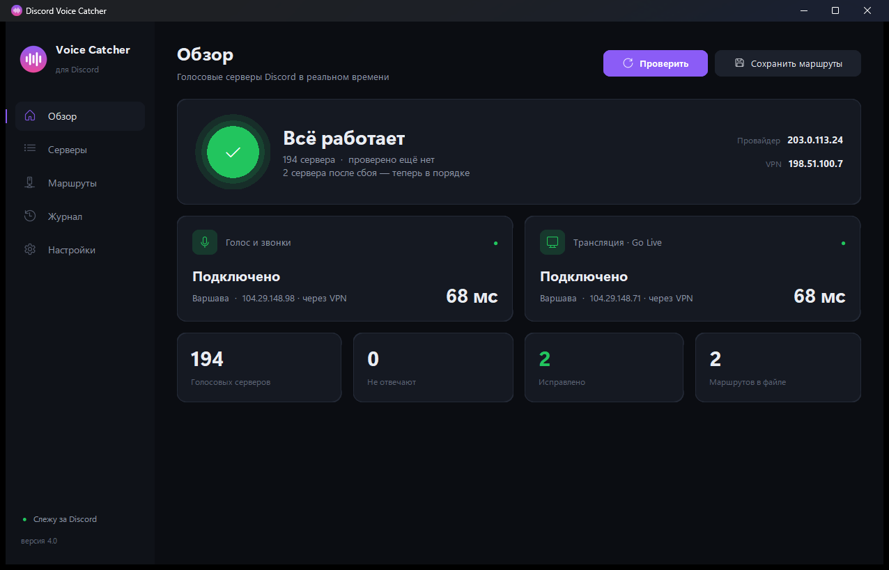
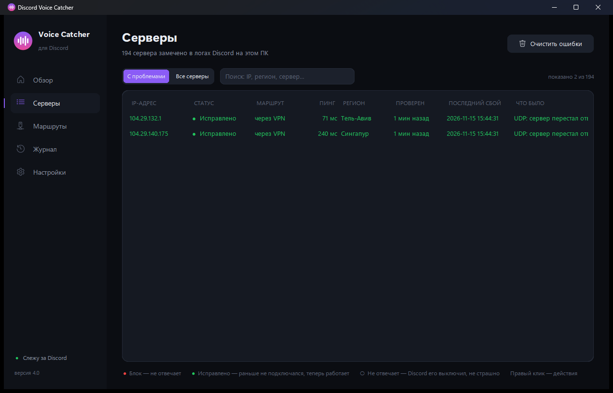
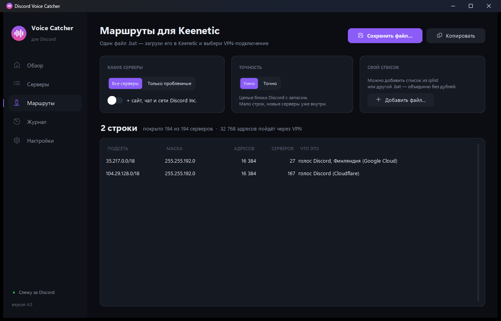

# Discord Voice Catcher

Программа для Windows, которая следит за логами Discord, ловит голосовые серверы, к которым не удаётся подключиться, и собирает **готовый файл маршрутов для роутера Keenetic**. Через этот файл голос, звонки и трансляции Discord идут через VPN.



## Зачем это нужно

Сайт и чат Discord работают по доменам, поэтому их можно завернуть в VPN DNS-правилом. А голос и видео идут по UDP напрямую на IP-адреса медиасерверов (`104.29.x.x`, `35.217.x.x` и т.д.), и в DNS этих адресов нет. Списки, собранные по доменам (например, в iplist), такие серверы пропускают и в то же время захватывают миллионы лишних адресов.

Discord Voice Catcher берёт адреса прямо из логов Discord на твоём ПК и собирает из них несколько аккуратных подсетей. Каждая подсеть покрывает целый блок голосовых серверов Discord и не задевает соседей.

## Возможности

- **Слежение в реальном времени.** Видно, подключён ли голос и трансляция (Go Live), к какому серверу, через VPN или напрямую, и какой пинг.
- **Сбор всех голосовых серверов.** Источники: твои подключения, тест регионов, который Discord проводит сам, и обрывы UDP.
- **Активная проверка.** Программа отправляет серверам тот же UDP-пакет «IP discovery», что и Discord, и узнаёт, отвечает ли сервер и каким путём (через VPN или напрямую). Проверка идёт автоматически по расписанию, при запуске и через 90 секунд после сбоя.
- **Понятные статусы:**
  - **Блок**: сервер не отвечает, и это подтверждено сбоем в звонке.
  - **Исправлено**: сервер раньше не подключался, а теперь работает.
  - **Не отвечает**: Discord просто выключил сервер, это не страшно.
- **Умные маршруты для Keenetic:**
  - **«Умно»**: целые блоки Discord с запасом, обычно 2–3 строки на всё.
  - **«Точно»**: только подсети /24, где серверы реально встречались.
  - Можно подмешать свой список, например из iplist. Слишком широкие сети программа предложит выкинуть.
- **Одна кнопка «Сохранить маршруты…»** спрашивает, куда сохранить, и пишет один `.bat` в формате `route add X mask Y 0.0.0.0`.
- **Трей, уведомления, автозапуск с Windows, тёмный интерфейс.**

| Серверы | Маршруты для Keenetic |
|---|---|
|  |  |

## Как запустить

### Готовый exe (проще всего)

1. Скачай `DiscordVoiceCatcher.exe` со страницы [Releases](../../releases/latest).
2. Запусти его. Устанавливать ничего не нужно, это один файл.
3. При первом запуске Windows может показать «Windows защитила ваш компьютер»: у программы нет цифровой подписи. Нажми «Подробнее», затем «Выполнить в любом случае».

Нужны Windows 10 или 11 и обычный Discord для ПК: браузерную версию программа не видит, у неё нет логов. Чтобы набрался список серверов, Discord должен поработать хотя бы несколько минут, а лучше зайти в голосовой канал.

### Из исходников

Нужен Python 3.10 или новее.

```bash
pip install -r requirements.txt
python discord_voice_catcher.py
```

Режим без окна, разбор логов в консоль:

```bash
python discord_voice_catcher.py --scan --check
```

Сборка exe:

```bash
powershell -ExecutionPolicy Bypass -File build.ps1
```

Тесты:

```bash
python test_live.py
```

## Как загрузить маршруты в Keenetic

1. В программе открой «Маршруты», выбери режим (по умолчанию «Умно») и нажми **«Сохранить файл…»**.
2. В веб-интерфейсе Keenetic открой раздел маршрутизации и импортируй сохранённый `.bat`.
3. При загрузке выбери своё VPN-подключение как интерфейс.

Если Discord начнёт пользоваться серверами вне известных блоков, в маршрутах появится новая строка. Тогда файл нужно сохранить и загрузить заново.

## Где программа хранит данные

`%USERPROFILE%\Documents\Discord Voice Catcher\`:

| Файл | Что внутри |
|---|---|
| `discord-routes.bat` | текущие маршруты для Keenetic |
| `ips.txt`, `all-ips.txt` | проблемные и все IP голосовых серверов |
| `domains.txt` | домены `*.discord.media` с ошибками |
| `report.csv` | полный отчёт: статусы, время, причины сбоев |
| `state.json` | внутреннее состояние программы |

Программа ничего не отправляет в интернет, кроме проверочных UDP-пакетов серверам Discord и STUN-запросов, по которым она определяет IP провайдера.

## Как это работает

| Где | Что ищем |
|---|---|
| `%APPDATA%\discord\logs\renderer_js.log` | `[RTCControlSocket] [CONNECT]` / `[WS CLOSED]`: подключение к сигнальному серверу; `Creating connection to IP:PORT`: медиасервер |
| `discord-webrtc_*` (нативный движок) | `Sending latency test ping to IP …`: тест регионов; `Ping timeout from …`: UDP перестал отвечать |

Известные блоки голосовых серверов взяты из реестров RIPE/RDAP:
- `104.29.128.0/18`: Discord на Cloudflare;
- `35.217.0.0/18`: Финляндия, Google Cloud;
- `34.0.128.0/19`: США, Google Cloud.
